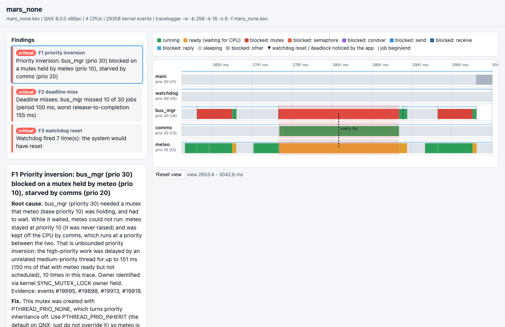

# Pathfinder: a real-time trace doctor for QNX 8.0

In July 1997 the Mars Pathfinder lander kept resetting itself. A low-priority task held a lock, a medium-priority task
kept the CPU, the high-priority bus task starved, the watchdog fired. It took engineers days to find because the evidence
was buried in a trace.

**Pathfinder reads a QNX kernel trace (`tracelogger` / `traceprinter`) and tells you what is wrong, why, and how to fix it,
with every claim pointing at the trace events that prove it.** It finds priority inversion (with the full blocking chain),
IPC deadlock cycles in MsgSend/MsgReceive, missed deadlines and CPU starvation, links them into a causal chain
(inversion -> deadline miss -> watchdog reset), and writes a single-file interactive HTML timeline.



Category: **Developer Tooling & Host Tools**. Built and verified on **QNX SDP 8.0** (QEMU x86_64 quick-start image,
instrumented kernel `procnto-smp-instr`), toolchain `qcc` 12.2.0.

## What it does, on real QNX 8.0 traces

Every row below was recorded on the QNX 8.0 VM by `scripts/e2e.sh` (traces are in `examples/traces`, reports in `examples/reports`).

| Scenario (on target, C) | Bug mode: what Pathfinder reports | Fix mode |
|---|---|---|
| `mars none` - 4 SCHED_FIFO threads, shared lock, **mutex with `PTHREAD_PRIO_NONE`** | **Priority inversion**: `bus_mgr` (30) blocked on a mutex held by `meteo` (10), which was never boosted, starved by `comms` (20) for up to ~150 ms, 10 times -> **10 of 30 deadline misses -> watchdog fired 7x** | `mars inherit` (`PTHREAD_PRIO_INHERIT`, the QNX default): clean, plus proof: `meteo` raised 10 -> 30 while `bus_mgr` waited. `mars protect` (priority ceiling): clean |
| `mars sem` - same, lock is a **POSIX semaphore** | Same inversion; owner recovered from `pf_mark` lock markers (a semaphore has no kernel-visible owner: `SYNC_SEM_* owner:-4`) | use a PRIO_INHERIT mutex |
| `ipc_deadlock bug` - two servers call each other from their handlers | **IPC deadlock**: `ping_srv -> pong_srv -> ping_srv`, 2 clients blocked behind it for 1.2 s | `fix`: reply first, notify with `MsgSendPulse`: clean |
| `deadline bug` - 10 ms loop, 25 ms critical section in a logger | **Long critical section** (inheritance worked, so it is *not* an inversion) -> deadline misses | `fix`: copy under the lock, slow work outside: clean |
| `starve bug` - prio-40 150 ms burst vs a 20 ms prio-20 task | **CPU starvation** of `ctrl` for up to 140 ms -> 39 of 98 jobs late | `fix`: hog below `ctrl`: clean |

Accuracy note: on QNX a plain `pthread_mutex_t` already uses `PTHREAD_PRIO_INHERIT`
(see `pthread_mutexattr_init` in the SDP docs), so the Mars bug needs an explicit `PTHREAD_PRIO_NONE` or a semaphore.
Pathfinder says so in its explanation instead of reciting a generic "enable priority inheritance".

## How it works

```
 QNX 8.0 target (QEMU)                       host (any OS with python3)
 target/*.c  scenarios + pf_mark.h   ---->   scripts/pf-run.sh:  tracelogger -w  ->  .kev  ->  traceprinter
 tracelogger -w  (wide events: every                                  |
 thread event carries priority)                                       v
                                      host/pathfinder (python3, stdlib only)
                                       parse    traceprinter text -> events with ids (#n)
                                       model    per-thread RUN/READY/BLOCKED intervals + priority at each change,
                                                lock owners (SYNC_MUTEX_LOCK owner field), IPC edges (rcvid, coid, chid)
                                       detect   inversion | IPC deadlock | deadline miss | starvation | watchdog
                                       explain  root cause + fix text from the numbers; optional LLM narrative
                                       render   report.html (inline SVG/JS, zoom/pan, click a finding), .md, .json
```

QNX-specific techniques used: instrumented-kernel event tracing, wide-mode thread events (priority/policy), user trace events via
`TraceEvent(_NTO_TRACE_INSERTUSRSTREVENT)`, kernel mutex/semaphore/message-passing events (`SYNC_MUTEX_LOCK`, `THSEND`, `THREPLY`,
`SND_MESSAGE`/`REC_MESSAGE` rcvid matching, `CONNECT_ATTACH` coid -> chid), priority protocols (`PTHREAD_PRIO_NONE/INHERIT/PROTECT`),
`TimerTimeout`, runmask pinning for deterministic SMP experiments.

## Quick start

See [docs/RUN.md](docs/RUN.md) for the complete, verified build and run instructions (QNX version, target, toolchain).

```
source ~/qnx800/qnxsdp-env.sh && make -C target          # qcc -Vgcc_ntox86_64  (or ARCH=aarch64le)
scripts/qnx-vm.sh start                                   # QNX 8.0 quick-start image under QEMU (no KVM needed, ssh in ~20 s)
scripts/pf-run.sh mars none 3                             # record a kernel trace of the Mars bug on the target
python3 -m pathfinder analyze examples/traces/mars_none.txt.gz --out report   # run from host/
open report/mars_none.html
scripts/e2e.sh                                            # all scenarios, bug + fix, with assertions
```

No QNX at hand? `python3 -m unittest discover host/tests` and `python3 -m pathfinder analyze examples/traces/*.txt.gz`
work on the committed real traces with nothing but Python.

## Optional LLM narrative

`--llm` sends only the structured findings and the few cited event lines to the Anthropic API and asks for claims that each cite event
ids. Claims with unknown or missing ids are dropped (`host/pathfinder/llm.py`), so the narrative cannot add facts that are not in the
trace. Off by default; the key comes from the environment, never from the repo.

## Limitations (honest list)

* Mutex owner identification uses the owner field of contended `SYNC_MUTEX_LOCK` (low 16 bits = owner tid, same process). Cross-process mutexes in
  shared memory and semaphores need `pf_mark.h` lock markers.
* IPC deadlock detection covers SEND/REPLY wait-for cycles; it does not follow pulses, events or locks inside the cycle.
* Deadline detection needs `pf_period_begin/end` markers (periods are inferred from them).
* The target image used here has 4 emulated CPUs; scenarios pin their threads to CPU 0 (`_NTO_TCTL_RUNMASK`) to make inversion deterministic.
* Tested on x86_64 QEMU. The C sources also build for `aarch64le`; no aarch64 trace was recorded.

## Layout

```
target/   mars.c ipc_deadlock.c deadline.c starve.c pf_mark.h pf-capture.sh Makefile      (build with qcc)
host/     pathfinder/ (parse, model, detect, explain, render, llm, cli)  tests/
scripts/  qnx-vm.sh pf-run.sh e2e.sh docker-make.sh traceprinter.sh
examples/ traces/ (real .kev + traceprinter dumps)  reports/ (generated HTML/MD/JSON)
docs/     RUN.md  CODELAB.md  SUBMISSION.md  codelab/inversion.c  Dockerfile.sdp-env
```

## AI disclosure and license

Written with the help of an AI coding assistant (Claude); all code was executed and verified on QNX 8.0 as described above.
Licensed under the Apache License 2.0 (see `LICENSE`). QNX and Neutrino are trademarks of BlackBerry Limited; this project is not affiliated with or endorsed by them.
